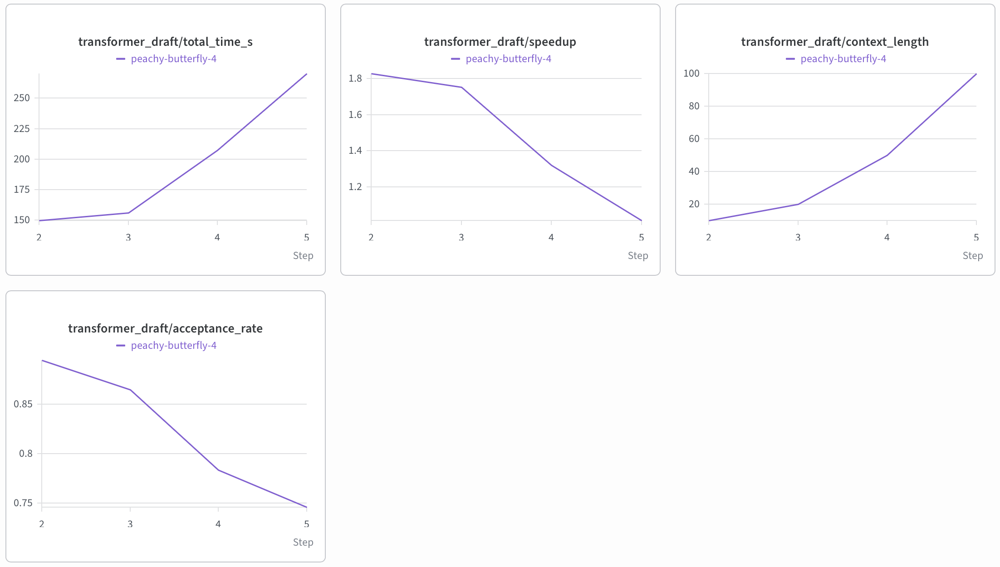

# Speculative Decoding for LLM Inference Acceleration: From Theory to Production


## 1. Abstract & Objective

This project is a fully functional, scalable PyTorch implementation of the **Speculative Decoding** pipeline. The primary objective is to bridge the gap between academic concepts of mitigating the autoregressive generation bottleneck in Large Language Models (LLMs) and a production-ready inference pipeline.

Instead of relying on standard token-by-token generation, the pipeline utilizes a smaller, highly efficient "draft" model to propose sequence candidates. A larger "target" model then evaluates these proposals in a single, highly-parallelized forward pass. The architecture is optimized for maximum computational efficiency by strictly controlling tensor limits and context lengths during the verification phase.

## 2. Architecture & Mathematical Formulation

The model consists of several key mechanisms designed to reduce inference latency while guaranteeing that the final output distribution perfectly matches the target model:

### 2.1 Speculative Proposal & Verification

Given a context prefix, a computationally cheap draft model (e.g., `gemma-3-1b-pt`) autoregressively proposes $K$ subsequent tokens: $t_1, \dots, t_K$.
The expensive target model (e.g., `gemma-3-4b-pt`) is then run exactly once on the extended sequence $[\text{prefix}, t_1, \dots, t_K]$.

### 2.2 Parallel Acceptance Criterion

The target model $p_{\text{target}}(\cdot \mid \text{prefix})$ acts as a verifier. For each $i = 1, \dots, K$, the system checks in parallel whether the proposed token matches the target model's greedy prediction:
$$t_i = \arg\max\; p_{\text{target}}(\cdot \mid \text{prefix}, t_1, \dots, t_{i-1})$$
Let $j$ be the largest index such that this equality holds for all preceding tokens. The pipeline accepts tokens $t_1, \dots, t_j$, discards the rest, and seamlessly appends the target model's confident prediction for position $j+1$.

## 3. Visualizations

The architecture's evaluation is tracked in Weights & Biases. The charts below demonstrate the inference acceleration and the draft model's acceptance dynamics.

### The Context Length Paradox


*Figure 1: Performance trends of the Transformer draft model across increasing context lengths. The charts illustrate a direct increase in total time and context length. Conversely, speedup and acceptance rate exhibit a sharp decline as context length grows.*

## 4. Evaluation Metrics & Results

Pipeline performance was benchmarked on the WikiText-2 dataset using an NVIDIA T4 GPU. The target model was `google/gemma-3-4b-pt`.

| Strategy | Key Hyperparameters | Acceptance Rate | Execution Time | Speedup |
| :--- | :--- | :--- | :--- | :--- |
| **Baseline Autoregressive** | Context = 20 | N/A | ~273.80s | 1.00x |
| **Bigram Speculative** | $K = 4$, Context = 20 | ~2.20% | ~261.46s | ~1.05x |
| **Transformer Speculative** | $K = 4$, Context = 10 | **~89.44%** | **~149.76s** | **~1.83x** |
| **Transformer Speculative** | $K = 4$, Context = 20 | ~86.45% | ~156.18s | ~1.75x |
| **Transformer Speculative** | $K = 4$, Context = 50 | ~78.36% | ~207.40s | ~1.32x |
| **Transformer Speculative** | $K = 4$, Context = 100| ~74.59% | ~270.22s | ~1.01x |

### Inference Strategy Analysis

Several draft strategies were evaluated to optimize the decoding pipeline:

- **Transformer Draft (Ctx 10 - Best):** Generating with a small context window of 10 tokens achieved an exceptional acceptance rate of 89.44%, yielding an execution time of 149.76s and an optimal ~1.83x speedup.
- **Transformer Draft (Ctx 100 - Paradox):** Expanding the context to 100 tokens dropped the acceptance rate to 74.59% and increased execution time to 270.22s, negating the speedup (1.01x). This demonstrates that as the sequence grows, the 1B draft model's attention mechanism diverges from the 4B target's reasoning, heavily penalizing inference speed with rejection overhead.
- **Bigram Draft (Worst):** The naive statistical bigram model achieved a dismal 2.20% acceptance rate, failing to approximate the LLM's distribution and providing virtually no acceleration.

## 5. Quick Start

The project uses `uv` for ultra-fast dependency and virtual environment management. All routine processes are encapsulated within the `Makefile`.

```bash
# Clone the repository and install dependencies
git clone https://github.com/Pavelpuff/speculative-decoding-eval.git
cd speculative-decoding-eval
make setup

# Authenticate with HuggingFace (Required for Gemma weights)
export HF_TOKEN="your_token_here"

# Cache WikiText-2 and Model Weights
make download-data
make download-weights

# Run the full evaluation pipeline
make evaluate
```